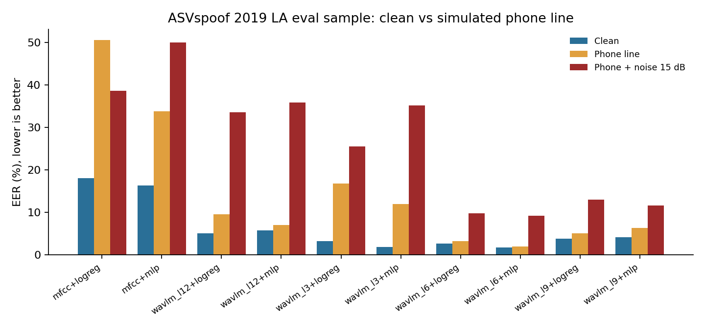
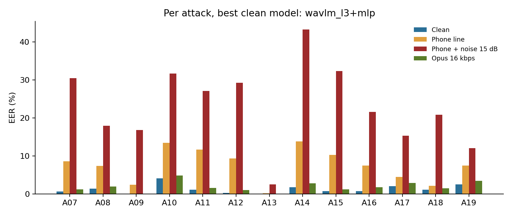

# VoiceGuard: speech deepfake detection under phone-line conditions

**Working title:** Beyond Clean Audio: Calibrated Cross-Lingual Detection of AI-Generated Speech under Telephony Degradation and Unseen Voice Generators.

**Status:** v0.2.0 adds the first runnable baseline (code, tests and a Kaggle notebook). Results will be added only from completed runs. This is not yet a validated detector or a paper.

## Problem
AI-generated and cloned speech can support impersonation and social-engineering attacks. Detectors can fail when the generator, language, recording channel, codec, or noise differs from training data.

## Proposed application
A Hugging Face demo where a user uploads a short audio clip and receives a risk estimate (likely bona-fide / likely synthetic or manipulated / uncertain), calibrated confidence, audio-quality warnings, and limitations. It must not claim forensic certainty or replace bank or law-enforcement checks.

## Demo
**Try it: [huggingface.co/spaces/MHkhan50/voiceguard-fake-voice-check](https://huggingface.co/spaces/MHkhan50/voiceguard-fake-voice-check)**

A research demo of the layer 6 + MLP model runs in the browser as a static Hugging Face Space (upload or record a
clip; the audio never leaves the device). Its source is in [`demo/`](demo/); it is built and checked against the
experiment pipeline by [`notebooks/voiceguard_publish_space.ipynb`](notebooks/voiceguard_publish_space.ipynb), and
the ONNX model is stored in the Space, not in git.

Informal checks by the author with the first demo model (v0.3 features; a handful of clips, not a benchmark): his
own voice recorded on a laptop microphone scored 0.3% "AI voice", but a real English WhatsApp voice note uploaded as
a file scored 97.4%, and 99.9% when the same note was played through a speaker and recorded again. A detector
trained only on ASVspoof 2019 LA studio recordings can therefore flag real voices that passed through a messaging app
or a loudspeaker.

After the padding fix (v0.4 demo model), the same WhatsApp file scored 93.6% ("Uncertain"), a new replayed recording of
the note 95.5% ("Likely AI-generated") and a new laptop recording 0.0%: better, but the false alarm on replayed audio
remains.

## Proposed contribution
Study generator-disjoint generalisation, cross-language variation, telephone-channel degradation, calibration and selective abstention, and resource-efficient inference. Novelty is not established: a systematic literature review and data audit must precede any novelty claim.

## Research questions
1. How much does performance degrade on unseen voice generators?
2. How do telephone filtering, codecs, background noise, and reverberation affect errors?
3. How stable are results across languages and speaker populations represented in the data?
4. Can calibration and abstention reduce high-confidence errors under distribution shift?
5. What accuracy/latency/memory trade-off is achievable with a compact model?

## Planned technical route
Start with frozen WavLM or wav2vec 2.0 representations plus a lightweight neural classifier. Compare with acoustic-feature baselines and, if feasible, AASIST. Use group-aware splits by speaker, corpus, and generator. Calibrate only on a separate validation set.

## Planned deliverables
Runnable training/evaluation code; documented dataset and split manifests; robustness benchmark; model card; Hugging Face demo; research manuscript with statistical analysis and limitations.

## Baseline experiments (v0.4)
A pilot on one well-documented dataset before the cross-lingual stage.

| Part | Choice |
|---|---|
| Data | ASVspoof 2019 LA (Kaggle input `awsaf49/asvpoof-2019-dataset`; audio is not copied into this repo). Its train, dev and eval sets have different speakers. |
| Unseen generators | Training contains attacks A01-A06. Eval contains A07-A19; A16 and A19 reuse the A04 and A06 algorithms, so they are reported as known and left out of the unseen-attack EER. |
| Sample | All 25,380 training clips; dev 1,000 bona fide + up to 170 per attack (calibration only); eval up to 600 clips per attack + 2,000 bona fide, fixed seed 42. Clip IDs are saved in `manifest.json`. |
| Channel conditions | Clean; simulated phone line (8 kHz, 300-3400 Hz band, G.711-style mu-law); phone line with white noise at 15 dB SNR; low-bitrate Opus (16 kbps, VoIP mode, encoded and decoded with ffmpeg/libopus) (`src/voiceguard/channel.py`). Training uses clean audio only. |
| Features | Frozen WavLM Base+ hidden states (layers 3, 6, 9, 12, mean-pooled over the first 4 s); MFCC mean and standard deviation as an acoustic baseline. From v0.4 each batch holds clips of equal length, so no clip is zero-padded (see below). |
| Classifiers | Logistic regression (balanced classes) and a one-hidden-layer MLP. v0.2: Platt calibration fitted on dev only. v0.3: an affine map to log-likelihood ratios fitted on dev with equal class weights, then a probability at the stated spoof share of the eval sample (Platt kept for comparison). |
| Metrics | EER with bootstrap 95% CI, Cllr and minCllr (v0.3; independent of the class mix), EER per attack and on unseen attacks, ROC-AUC, ECE (before and after calibration), Brier score, error at 100/90/80/70/50% coverage (abstention). A majority-class baseline is included. |

### Run on Kaggle
1. New notebook, *File > Import notebook*, paste the GitHub link to `notebooks/voiceguard_kaggle_baseline.ipynb`.
2. Settings: GPU T4 x2 or P100, Internet on; *Add Input*: `awsaf49/asvpoof-2019-dataset`.
3. Run all. The pilot cell checks the whole pipeline on a small sample first; the full run prints progress and an ETA.
4. Download `voiceguard_results.zip` from the Output panel.

### Run the tests locally (no GPU, no audio)
```bash
python3 -m venv .venv && source .venv/bin/activate
pip install -r requirements.txt
python -m pytest -q
```
The tests cover protocol parsing, the phone-line simulation, the metrics, the classifiers and a full mock run of the Kaggle runner with a fake feature extractor.

### Results (v0.4: Kaggle run, 9 Nov 2026, GPU T4 x2, 37.5 min)
Sample: 25,380 training clips, 2,020 dev clips, 9,800 eval clips (2,000 bona fide, 600 per attack), each eval clip in
four conditions. Full tables: [`results/tables.md`](results/tables.md); all numbers: [`results/results.json`](results/results.json);
clip IDs: [`results/manifest.json`](results/manifest.json).

EER % [bootstrap 95% CI], seed 42, lower is better:

| Features + classifier | Clean | Phone line | Phone + noise 15 dB | Opus 16 kbps |
|---|---|---|---|---|
| MFCC + logistic regression | 19.7 [19.0, 20.6] | 50.3 [48.9, 51.7] | 37.3 [36.4, 38.4] | 15.3 [14.5, 16.0] |
| MFCC + MLP | 15.0 [14.3, 16.0] | 40.3 [39.5, 41.2] | 50.0 [49.9, 50.0] | 12.6 [11.8, 13.2] |
| WavLM layer 3 + MLP | 1.8 [1.4, 2.3] | 9.2 [8.5, 10.2] | 24.6 [23.6, 25.7] | 2.3 [1.9, 2.8] |
| WavLM layer 6 + logistic regression | 2.6 [2.2, 3.1] | 3.2 [2.7, 3.6] | 10.5 [9.8, 11.2] | 3.3 [2.8, 3.7] |
| **WavLM layer 6 + MLP** | **2.1 [1.8, 2.4]** | **2.2 [1.8, 2.5]** | **9.5 [8.8, 10.2]** | **2.4 [2.1, 3.0]** |
| WavLM layer 9 + MLP | 3.4 [3.0, 3.9] | 5.7 [5.1, 6.3] | 9.5 [8.9, 10.3] | 3.6 [3.2, 4.0] |
| WavLM layer 12 + logistic regression | 5.2 [4.7, 5.8] | 13.2 [12.3, 14.1] | 39.3 [38.4, 40.3] | 4.6 [4.3, 5.2] |

Three classifier seeds (42, 43, 44; same clips and features). EER % mean (sd):

| Features + classifier | Clean | Phone line | Phone + noise 15 dB | Opus 16 kbps |
|---|---|---|---|---|
| MFCC + MLP | 16.3 (1.1) | 40.6 (3.5) | 50.8 (0.8) | 13.4 (0.7) |
| WavLM layer 3 + MLP | 2.1 (0.4) | 6.9 (2.2) | 23.6 (1.3) | 2.5 (0.4) |
| **WavLM layer 6 + MLP** | **1.7 (0.3)** | **2.2 (0.1)** | **8.1 (1.4)** | **2.1 (0.3)** |
| WavLM layer 9 + MLP | 3.5 (0.1) | 5.8 (0.3) | 8.9 (0.8) | 3.7 (0.1) |
| WavLM layer 12 + MLP | 5.6 (0.1) | 6.0 (0.4) | 27.0 (5.0) | 5.6 (0.1) |

Logistic regression is fitted deterministically, so its results are identical across seeds (sd 0). Three seeds give
only a rough spread; per-seed values are in `results/results.json` (`seed_summary`).

What the run shows:
- **The layer matters more than the classifier under shift.** On clean audio layers 3 and 6 are close (2.1% and 1.7%
  mean with the MLP), but on the phone line layer 3 rises to 6.9% while layer 6 stays at 2.2%. With noise, layers 3
  and 12 reach 24-27% while layers 6 and 9 stay at 8-9%. Layer 6 + MLP is the most stable model in every condition.
- **The phone line alone breaks the MFCC baseline** (EER 40-50%, close to chance), while the best WavLM features
  barely move. Adding noise is the hardest condition for every model.
- **Low-bitrate Opus costs little on this data.** For layer 6 + MLP the mean EER is 2.1% with Opus against 1.7% clean,
  and its Cllr stays low (0.11). Only the MFCC models are badly calibrated after Opus (Cllr 1.0-1.7). The real
  WhatsApp voice note that the browser demo misjudged (see the demo section) is therefore not explained by a 16 kbps
  Opus round trip alone; the recording device and app processing also differ from ASVspoof 2019 LA.
- **Single MLP runs are unreliable with noise.** Across seeds, layer 12 + MLP ranged from 23.1% to 32.6% and layer 3
  + MLP from 22.1% to 24.6%; layer 6 + MLP stayed between 6.8% and 9.5%.
- **Per attack (layer 6 + MLP):** with noise, A18 rises from 3.2% to 26.3%, A17 from 1.1% to 20.9% and A19 from 4.6%
  to 18.0%; the other attacks stay below 9%. A19 reuses a training algorithm (A06) and is still among the hardest.
- **Abstention helps only when the model is uncertain in the right places.** For layer 6 + MLP with noise, the error
  falls from 9.0% on all clips to 4.1% on the 80% it is most confident about and 1.9% at 50%. For layer 3 + logistic
  regression with noise, the error stays between 45% and 51% at every coverage: the model is confidently wrong.
- **Calibration does not transfer to the noisy phone line.** Cllr is the cost of the scores as evidence (in bits; 0
  is perfect, 1 equals always answering "I don't know") and minCllr is the same after the best possible recalibration.
  In 12 of 40 model and condition pairs Cllr was above 1, including five of the eight WavLM models with noise (all
  except layer 6 with either classifier and layer 3 + MLP at 0.97), while
  minCllr stayed much lower: for layer 12 + MLP with noise, Cllr 3.49 against minCllr 0.64. The scores still rank clips
  reasonably, but a calibration fitted on clean dev audio is far too confident on the noisy line. The log-likelihood
  ratio calibrator (equal class weights on dev) gave lower ECE than Platt scaling in 25 of 40 pairs.

| Layer 6 + MLP | Clean | Phone line | Phone + noise 15 dB | Opus 16 kbps |
|---|---|---|---|---|
| Cllr | 0.244 | 0.123 | 0.625 | 0.126 |
| minCllr | 0.076 | 0.088 | 0.337 | 0.091 |
| ECE (LLR calibration at the eval spoof share) | 0.031 | 0.010 | 0.060 | 0.013 |

Full calibration table for all models: [`results/tables.md`](results/tables.md#calibration).

**Zero padding changed the features (fixed in v0.4).** Up to v0.3, clips were zero-padded to the longest clip in each
batch of 48. WavLM Base+ normalises its first convolution over time (group norm), so the padding changed the features
of shorter clips. Checking the browser demo (one unpadded clip at a time) against the v0.3 features on 920 eval clips,
the mean difference in log-likelihood ratio was 0.01 for clips cut at 4 s (never padded) but 0.41 for 3-4 s clips,
1.07 for 2-3 s clips and 2.98 for clips under 2 s, and the verdict agreed on 100%, 99.1%, 96.8% and 89.0% of them.
From v0.4 each batch holds clips of equal length. The headline numbers moved by up to a few points (layer 6 + MLP,
clean: 1.8% before, 2.1% after); the conclusions above hold in both versions.




### Limitations of this baseline
- One English corpus. The licence and content audit for the cross-lingual stage is in [`docs/data_audit.md`](docs/data_audit.md): MLAAD is non-commercial (CC BY-NC 4.0) and has matching real speech (M-AILABS) in only 8 of its 51 languages.
- The phone line and the Opus condition are simulated, not recorded over a real network or app.
- Three classifier seeds, but one clip sample and one feature extraction; the sd does not cover sampling variation.
- Calibration is fitted on clean dev audio only; it does not transfer to the noisy phone line (see Cllr above).
- Accuracy-type errors depend on the 80% spoof share of the eval sample; EER is the main measure.

## Hardware
Local machine: MacBook with Apple M4 and 16 GB unified memory. Feature extraction runs on a Kaggle GPU; local work is limited to tests and analysis.
